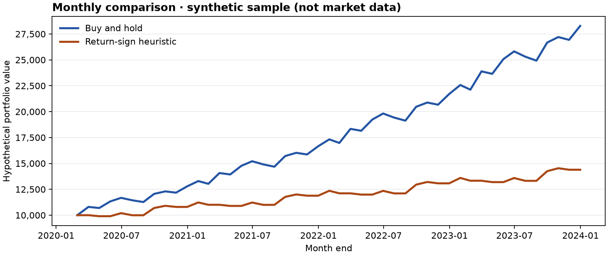

# Poker-Inspired Monthly Return Research

**The return-sign heuristic lost to buy-and-hold in the historical AAPL example.**
This small Python experiment shows how to test a fixed decision rule against a
simple baseline on the same dates. The poker analogy is the inspiration; the
code does not model a poker game, estimate probabilities, or learn a strategy.



## Quick start: no market data needed

Use **Python 3.12**. Installing dependencies requires internet access; the
synthetic example and tests run offline after that.

```sh
git clone https://github.com/0xmrpinheiro/poker-game-theory-research.git
cd poker-game-theory-research
```

**macOS / Linux**

```sh
python3.12 -m venv .venv
.venv/bin/python -m pip install -r requirements.txt
.venv/bin/python poker_trading_algorithm.py --sample --plot poker-comparison.png
```

**Windows PowerShell**

```powershell
py -3.12 -m venv .venv
.\.venv\Scripts\python.exe -m pip install -r requirements.txt
.\.venv\Scripts\python.exe poker_trading_algorithm.py --sample --plot poker-comparison.png
```

Open `poker-comparison.png` to see both curves starting at 10,000. The chart
above is from this synthetic example, not the AAPL run.

## Reproduce the historical AAPL comparison

With the virtual environment active:

```sh
python poker_trading_algorithm.py --ticker AAPL --start 2010-01-01 --end 2023-01-01
```

The script downloads adjusted daily closes from Yahoo Finance and uses the
last available close of each month. The date range uses a first-of-month start
and exclusive end. Two monthly returns warm up the rule: both portfolios
start at the **March 2010 close** and are evaluated from **April 2010 through
December 2022** (153 months).

| AAPL comparison | Final hypothetical value | Cumulative return |
| --- | ---: | ---: |
| Return-sign heuristic | 108,777.22 | +987.77% |
| Buy and hold | 181,613.13 | +1,716.13% |

These are results from one download, using 10,000 in starting capital without
trading costs. Adjusted historical data can change. For a frozen input, supply
your own CSV with `Date` (ISO date) and `Close` (adjusted month-end close)
columns, one row per consecutive month:

```sh
python poker_trading_algorithm.py --csv monthly-closes.csv --plot comparison.png
```

## How the comparison works

- The heuristic is exposed for the next month if the most recent monthly return
  was positive **or** the two most recent returns were both non-positive.
  Otherwise it stays in cash. It never uses the month being scored to decide
  that month's exposure.
- Buy-and-hold stays fully exposed for every scored month. Both use the same
  adjusted-close returns and starting capital. The calculation assumes
  rebalancing at month-end closes and zero return on cash.
- The script also counts overlapping three-month sign patterns. These counts
  are descriptive only and do not choose the rule.

This is one retrospective, single-ticker comparison. It does not account for
fees, slippage, or taxes, and it does not establish future performance. It is
educational research, not a trading system or investment advice.

## Tests

```sh
python -m unittest discover -s tests -v
```

Related public experiment: [LSTM Equity Sequence Modeling](https://github.com/0xmrpinheiro/lstm-equity-sequence-modeling)
compares one-step forecast errors against a previous-close baseline.

Licensed under [GPL-3.0](LICENSE).